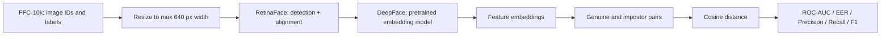

# FFC-10k | Face Verification Benchmark

**SIBGRAPI 2026 · Workshop of Undergraduate Works (WUW)**  
*A Comparative Evaluation of Pretrained Face Embedding Models for Face Verification*

A research benchmark of **11 pretrained face-embedding models** evaluated under a standardized face verification protocol. This repository contains **dataset selection metadata**, an **ArcFace evaluation notebook**, and the **published-study results in both readable and CSV formats**.

> **Scope:** This repository shares a **partial reproducibility example**, not a fully automated 11-model benchmark. The original image datasets and model weights are not redistributed. The numerical results are transcribed from the research manuscript, not newly rerun here.

## At a glance

| Research dataset | Pretrained models | Data sizes | Repetitions |
| :---: | :---: | :---: | :---: |
| **10,000 images / 5,000 identities** | **11** | **1k, 2.5k, 5k, 10k images** | **5 folds** |

**Key findings on the 10,000-image subset:**

| Model | ROC-AUC ↑ | EER ↓ | F1 ↑ | Extraction time (10k) |
| :--- | ---: | ---: | ---: | ---: |
| **ArcFace** | 0.9978 | 1.34% | **0.8170** | 46m 19s |
| **FaceNet512** | **0.9980** | **1.03%** | 0.7958 | 57m 45s |
| **FaceNet** | **0.9980** | 1.60% | 0.7958 | 53m 25s |

**ArcFace** had the highest F1-score in the full comparison; **FaceNet512** had the lowest EER. Different metrics lead to different model choices. Timings represent **sequential embedding extraction on a laptop RTX 4050**, not production-level latency.

📊 **[Explore the complete 11-model results](BENCHMARK_RESULTS.md)** · **[CSV results](benchmark_results_10k.csv)** · **[Reproducibility instructions](REPRODUCIBILITY.md)**

## Face verification pipeline

**Experimental design:**
1. **Build FFC-10k:** curate two images for each of 5,000 identities, combining selections from seven public datasets.
2. **Preprocess uniformly:** resize while preserving aspect ratio; apply RetinaFace detection and alignment.
3. **Extract embeddings:** compare 11 pretrained face recognition models through a common pipeline.
4. **Verify identities:** generate genuine and impostor pairs and compute cosine distances.
5. **Evaluate:** ROC-AUC, EER, precision, recall, and F1; compare four subset sizes with five repeated folds.
6. **Assess computational costs:** embedding dimensionality and sequential extraction time on a fixed hardware setup.

### Evaluated models

VGG-Face · FaceNet · FaceNet512 · OpenFace · DeepFace · DeepID · ArcFace · Dlib · SFace · GhostFaceNet · Buffalo L

## Repository files

| Resource | What you get |
| :--- | :--- |
| [`ArcFace-embeddings-v4.ipynb`](ArcFace-embeddings-v4.ipynb) | Public **ArcFace example notebook**, not every model |
| [`selected_images.csv`](selected_images.csv) | Source selection and identity-mapping metadata |
| [`BENCHMARK_RESULTS.md`](BENCHMARK_RESULTS.md) | Full reported results, interpretation, provenance, and caveats |
| [`benchmark_results_10k.csv`](benchmark_results_10k.csv) | Machine-readable 11-model comparison |
| [`REPRODUCIBILITY.md`](REPRODUCIBILITY.md) | Data preparation, notebook execution guidance, and limitations |

## About the dataset

**FFC-10k (Frontal Face Composition Dataset)** has **10,000 images of 5,000 identities** (two images per identity). The images were selected from:

- Selfies-and-Videos
- Selfies-and-ID
- Pins-Face
- FEI-Face
- FaceScrub
- MORPH-2
- BUPT-CBFace-12

The [institutional dataset construction guide](https://github.com/CEIA-NoLeakIV/FFC-Dataset-10k) provides the sourcing, folder structure, and construction methodology. This personal research repository **does not redistribute image files**. Users must obtain source data from its owners, subject to their permissions and terms.

## Research outcomes & limitations

- Performance and computation can differ substantially between pretrained models, even when embedding sizes are identical.
- There is **no universally best model on every metric**: ArcFace achieved the highest F1-score (0.8170), while FaceNet512 had the lowest reported EER (1.03%).
- Low scores for some models may be affected by library integration, normalization, and preprocessing choices; the study did not isolate these factors.
- Absolute F1/precision and decision thresholds depend on the pair-generation protocol and should not be generalized to real-world deployment without additional evaluation.
- The reported benchmark is **separate** from the CEIA team's submitted algorithm in **NIST FRTE 1:1**; the numbers shown here are **not** NIST assessment scores.

## Research attribution

**“A Comparative Evaluation of Pretrained Face Embedding Models for Face Verification”**  
João Gabriel Gralha and collaborators · **SIBGRAPI 2026, Workshop of Undergraduate Works (WUW)**.

The study and associated dataset resources were developed as collaborative research related to the **CEIA-UFG / NoLeak IV** project. [Institutional repository](https://github.com/CEIA-NoLeakIV/FFC-Dataset-10k).

For technical documentation and the provenance of reported values, see [BENCHMARK_RESULTS.md](BENCHMARK_RESULTS.md). This repository does not imply authorization to redistribute third-party data or weights.
